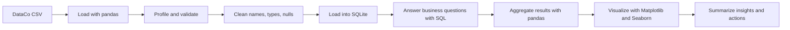
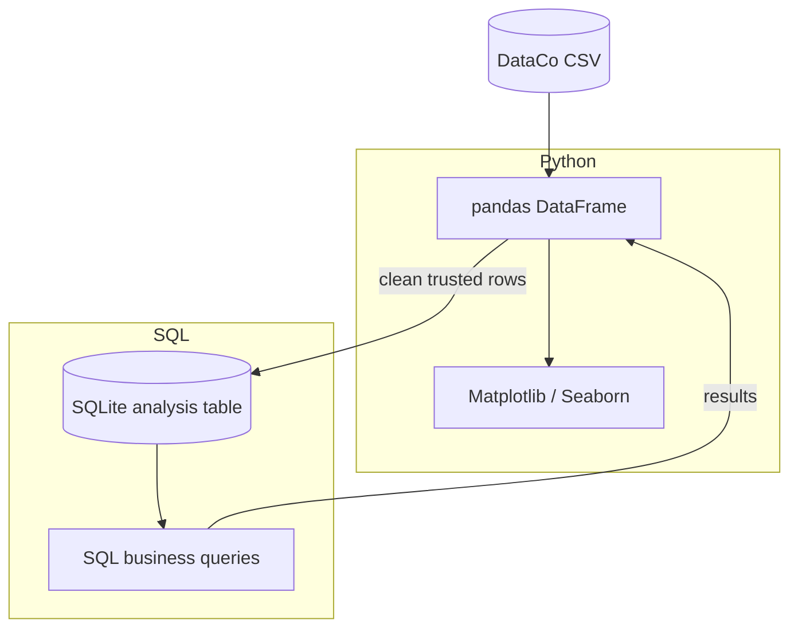

# DataCo Supply Chain Analysis


An end-to-end **DataCo Smart Supply Chain** analytics project using Python, SQL, and visual storytelling. The workflow turns raw order-level data into decision-ready insights about sales, delivery performance, product demand, customer behavior, and operational risk.

<details open>
<summary><strong>Interactive project tour</strong></summary>

- [Why this project matters](#why-this-project-matters)
- [What the workflow delivers](#what-the-workflow-delivers)
- [End-to-end workflow](#end-to-end-workflow)
- [Business questions](#business-questions)
- [Run the analysis](#run-the-analysis)
- [Technical architecture](#technical-architecture)
- [Portfolio value](#why-this-is-a-strong-supply-chain-project)

</details>

## Why this project matters

Supply chains fail when decisions are made from disconnected spreadsheets and delayed reports. This project demonstrates a practical analytics loop:

**raw data → trusted data → SQL metrics → visual evidence → business decisions**

Instead of showing isolated charts, the analysis connects commercial performance with execution performance. That makes it useful for finding where demand is strong, where delivery promises are missed, and which products, markets, or customer segments deserve attention.

## What the workflow delivers

| Layer | Output | Decision it supports |
|---|---|---|
| Data quality | Cleaned columns, types, missing-value checks, and duplicate checks | Can the analysis be trusted? |
| Commercial analytics | Revenue, order volume, product and category performance | What should the business prioritize? |
| Customer analytics | Customer segments, repeat behavior, and geographic demand | Where is demand coming from? |
| Logistics analytics | Shipping modes, delivery timing, and late-delivery patterns | Where is fulfillment underperforming? |
| SQL analysis | Reusable business queries over a SQLite database | Can the result be reproduced and audited? |
| Visualization | Matplotlib and Seaborn charts | Can stakeholders understand the evidence quickly? |

## End-to-end workflow



<details>
<summary><strong>Step-by-step explanation</strong></summary>

1. **Load:** import the DataCo sample CSV into a pandas DataFrame.
2. **Explore:** inspect dimensions, columns, data types, distributions, and missing values.
3. **Clean:** standardize column names, parse dates and numeric fields, and check duplicates and invalid records.
4. **Model for analysis:** write the trusted DataFrame into a local SQLite table.
5. **Query:** use SQL aggregations, filters, joins, and date logic to answer business questions.
6. **Visualize:** turn query results into charts that reveal trends, rankings, concentration, and exceptions.
7. **Recommend:** translate findings into actions for inventory, fulfillment, customer service, and management.

</details>

## Business questions

<details>
<summary><strong>Commercial performance</strong></summary>

- Which categories and products generate the most revenue?
- How do order volume and sales change over time?
- Are sales concentrated in a small set of products or markets?

</details>

<details>
<summary><strong>Customer and market demand</strong></summary>

- Which regions, countries, or customer segments create the strongest demand?
- Which customer groups show repeat or high-value behavior?
- Where could targeted campaigns or service improvements have the greatest impact?

</details>

<details>
<summary><strong>Logistics and delivery execution</strong></summary>

- Which shipping modes are associated with stronger or weaker delivery performance?
- Where are late deliveries concentrated by market, category, or time period?
- Which operational exceptions should be investigated first?

</details>

## Run the analysis

### Google Colab

1. Open the project notebook in Google Colab.
2. Upload the DataCo sample CSV when prompted.
3. Run **Runtime → Run all**.
4. Review the cleaning checks, SQL outputs, charts, and final insight summary.

The notebook is intentionally designed for a zero-setup analysis experience: pandas handles preparation, SQLite provides SQL analysis without a server, and Matplotlib/Seaborn provide the visual layer.

### Local Jupyter

```bash
python -m venv .venv
# Windows
.venv\Scripts\activate
# macOS/Linux
source .venv/bin/activate

pip install pandas matplotlib seaborn jupyter
jupyter notebook
```

Place the dataset in the notebook's expected input location, open the notebook, and run all cells in order. Keep the source dataset out of Git if it contains restricted or licensed data.

## Technical architecture



The project deliberately uses both pandas and SQL:

- **pandas** is effective for profiling, type conversion, cleaning, and chart preparation.
- **SQL** makes aggregations explicit, reusable, and familiar to analytics teams.
- **SQLite** keeps the project portable and reproducible without requiring a database server.
- **Matplotlib and Seaborn** communicate trends and exceptions to non-technical stakeholders.

## Why this is a strong supply-chain project

This is more than a data-cleaning exercise. It follows the same reasoning used in real supply-chain analytics:

| Supply-chain capability | Demonstrated in this project |
|---|---|
| Demand visibility | Analyze orders, revenue, products, customers, and markets |
| Inventory prioritization | Identify high-performing categories and products |
| Fulfillment control | Compare delivery behavior and late-shipment patterns |
| Network performance | Break results down by geography and shipping mode |
| Exception management | Surface outliers and underperforming segments |
| Management reporting | Convert SQL outputs into clear visual evidence |
| Reproducibility | Use a documented notebook and repeatable transformation steps |

The strongest portfolio signal is the connection between **what customers buy** and **how reliably the network fulfills it**. A business can grow sales and still lose trust through late delivery; this project makes both sides visible in one analysis.

## Suggested stakeholder readout

<details>
<summary><strong>Five-minute presentation flow</strong></summary>

1. **Executive headline:** state the biggest commercial and operational finding.
2. **Demand:** show the top categories, products, markets, or customer segments.
3. **Execution:** show delivery performance and the largest late-delivery concentrations.
4. **Root-cause direction:** connect the patterns across product, geography, time, and shipping mode.
5. **Action plan:** recommend one near-term operational action and one longer-term measurement improvement.

</details>

## Repository contents

The primary deliverable is the analysis notebook. Add the source notebook and any permitted, non-sensitive sample data alongside this README when publishing the complete project.

```text
.
├── README.md
├── DataCo_Python_SQL_Project_final.ipynb
└── dataco_sample.csv                 # optional; do not commit restricted data
```

## Data and responsible use

The DataCo dataset is commonly used for educational and portfolio analysis. Verify the dataset's license and distribution terms before publishing the raw CSV. Prefer sharing an anonymized or public sample and document any transformations that affect the results.

## Next improvements

- Add a dashboard layer with Streamlit or Power BI.
- Add automated data-quality assertions for schema, nulls, and duplicate keys.
- Add a calendar table for more robust time-series analysis.
- Add forecast and inventory-risk analysis.
- Package the cleaning and SQL steps into a repeatable pipeline.
- Add a small set of tests for key metrics and edge cases.

## License

No license has been selected yet. Add a license before accepting external contributions or redistributing datasets.
